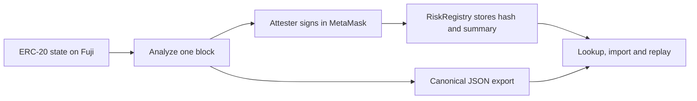

# AvaGuard

AvaGuard scans ERC-20 contracts on Avalanche Fuji and shows the evidence behind each risk signal. Each scan reads bytecode and state at one block. An authorized attester can record the report hash and summary in `RiskRegistry`. Anyone with the original JSON can look up that commitment and replay the scan at the original block.

Built by Team1 for Vietnam UniHack 2026.

## Review the Fuji evidence

Four reports were published with a real MetaMask attester on Fuji C-Chain (chain ID `43113`). All four original JSONs matched their registry commitments, and all four browser replays returned `replay-matches`. The independent registry readback checked the four reports together at block `61260827`. [G5 acceptance record](docs/releases/m7-fuji/g5-acceptance-2026-11-18.json)

| Showcase | Signal score | Snapshot block | Original JSON | Publication |
| --- | --- | --- | --- | --- |
| DemoBaselineToken | 0 / 100 · Few signals | `61245287` | [JSON](docs/releases/m7-fuji/avaguard-0x58d42e6710764c1753cad885fa80916a1f516fec-61245287.json) | [Receipt](docs/releases/m7-fuji/g5-baseline-publication-2026-11-17.json) |
| DemoMintPauseToken | 45 / 100 · Some signals | `61246821` | [JSON](docs/releases/m7-fuji/avaguard-0xe2f96ca00564cee3505ac3b22d4cf0f66b730ec6-61246821.json) | [Receipt](docs/releases/m7-fuji/g5-mintpause-publication-2026-11-18.json) |
| DemoTokenProxy | 60 / 100 · Many signals | `61260485` | [JSON](docs/releases/m7-fuji/avaguard-0xffad3eb4fbb259b1e76f84a66d6c0d005864d61c-61260485.json) | [Receipt](docs/releases/m7-fuji/g5-proxy-publication-2026-11-18.json) |
| DecoyConstantToken | 0 / 100 · Few signals | `61260797` | [JSON](docs/releases/m7-fuji/avaguard-0xfa73c98ece0639cb86da211e98e742289de5fcd4-61260797.json) | [Receipt](docs/releases/m7-fuji/g5-decoy-publication-2026-11-18.json) |

The deployment includes the registry, four showcase targets and the proxy implementation. Builder Hub source verification returned `Exact match` for all six. Find their addresses, source pages and deployment receipts in the [Fuji release evidence](docs/releases/m7-fuji/README.md). The [Vietnamese recording script and five-slide outline](docs/DEMO_SCRIPT.md) use the same reports. The recorded video and exported slide deck are pending.

## Run the Fuji demo locally

Use Node 24 and pnpm 12.4.2. Run from the repository root in PowerShell.

```powershell
pnpm install --frozen-lockfile

$env:AVAGUARD_ENV = 'fuji'
$env:FUJI_RPC_URL = 'https://api.avax-test.network/ext/bc/C/rpc'
$env:REGISTRY_ADDRESS = '0x003D1f3C26FfAC734297979B1FC82914217C5392'
$env:AVAGUARD_APP_ORIGIN = 'http://localhost:3001'
$env:AVAGUARD_AI_ENABLED = '0'

pnpm build
pnpm --filter @avaguard/web start -H 127.0.0.1 -p 3001
```

Open [Scan](http://localhost:3001/) and check for `Avalanche Fuji · 43113` in the header. This configuration uses the labeled `Template explanation`. A wallet is needed for publication by an authorized attester. Scan, lookup, import and replay work in a browser without a wallet.

### Reproduce the Mint/pause report

1. Save the [original Mint/pause JSON](docs/releases/m7-fuji/avaguard-0xe2f96ca00564cee3505ac3b22d4cf0f66b730ec6-61246821.json) without editing it.
2. Open [Lookup](http://localhost:3001/lookup), enter `0xE2F96cA00564CEE3505Ac3B22D4cF0F66B730eC6` and select **Find latest**. To select the recorded G5 publication, enter history index `0` and select **Read history entry**. Check that the snapshot is `61246821`.
3. Import the JSON. The app shows `Commitment matches. Hash and registry summary fields agree.`
4. Select **Replay original block**. When the RPC serves that snapshot, look for `Original-block replay: replay-matches`. **Scan current state** compares the report with a new snapshot.

To inspect a new snapshot, enter the same address on **Scan** and select **Scan contract**. **Export canonical JSON** saves that scan's report. Each export belongs to the block shown in its report.

## How the evidence fits together



The scanner records chain ID, block number, block hash, findings, coverage and observation methods. A signal score summarizes the weighted findings from those checks. The Mint/pause example has mint and pause dispatcher matches and an owner address with no runtime code at the snapshot. The Decoy example produced no weighted finding. `R-SOURCE-UNKNOWN` is a scope note about analyzer coverage. Builder Hub source verification is tracked in the deployment evidence.

## Contributor references

- [Product scope](docs/PRODUCT_SPEC.md), [scanner rules and limits](docs/SCANNER_SPEC.md), [trust boundaries](docs/THREAT_MODEL.md), [acceptance tests](docs/ACCEPTANCE.md) and [decisions](docs/DECISIONS.md).
- [Local Anvil and automated checks](docs/M5_DEMO.md), [Fuji delivery runbook](docs/M7_DELIVERY.md), [recording and slide outline](docs/DEMO_SCRIPT.md) and [milestone progress](docs/PROGRESS.md).
- [Implementation plan](docs/PLAN.md), [session plan](docs/M7_G3_G4_SESSION_PLAN.md), [source notes](docs/SOURCES.md), [historical RPC observations](docs/RPC_HISTORY_CHECK.md) and [project instructions](AGENTS.md).
