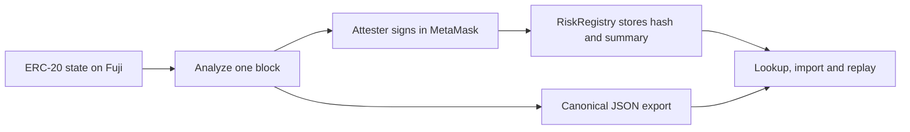

# AvaGuard

AvaGuard scans ERC-20 contracts on Avalanche Fuji and shows the evidence behind each risk signal. Each scan reads bytecode and state at one block. An authorized attester can record the report hash and summary in `RiskRegistry`. Anyone with the original JSON can look up that commitment and replay the scan at the original block.

Built by Team1 for Vietnam UniHack 2026.

## Start from a fresh clone

Install Git and Node.js 24 with npm. CI uses Node.js `24.19.0`. Open a new terminal after installation and run these commands from the folder where you want the clone. [Git installation](https://git-scm.com/install) · [Node.js installers](https://nodejs.org/en/blog/release/v24.19.0)

```sh
git --version
node --version
npm install --global pnpm@12.4.2
pnpm --version
git clone https://github.com/ChieNg00/AvaGuard.git
cd AvaGuard
pnpm install --frozen-lockfile
pnpm typecheck
pnpm lint
pnpm test
```

If PowerShell blocks an npm or pnpm script, use `npm.cmd` and `pnpm.cmd`. Type checking, linting and unit tests run with just the installed workspace. Continue with the [Fuji browser walkthrough](#run-the-fuji-demo-locally) or the [Solidity and browser tests](#run-the-solidity-and-browser-tests).

## Review the Fuji evidence

Four reports were published with a real MetaMask attester on Fuji C-Chain (chain ID `43113`). All four original JSONs matched their registry commitments, and all four browser replays returned `replay-matches`. The independent registry readback checked the four reports together at block `61260827`. [G5 acceptance record](docs/releases/m7-fuji/g5-acceptance-2026-11-18.json)

| Showcase | Signal score | Snapshot block | Original JSON | Publication |
| --- | --- | --- | --- | --- |
| DemoBaselineToken | 0 / 100 · Few signals | `61245287` | [JSON](docs/releases/m7-fuji/avaguard-0x58d42e6710764c1753cad885fa80916a1f516fec-61245287.json) | [Receipt](docs/releases/m7-fuji/g5-baseline-publication-2026-11-17.json) |
| DemoMintPauseToken | 45 / 100 · Some signals | `61246821` | [JSON](docs/releases/m7-fuji/avaguard-0xe2f96ca00564cee3505ac3b22d4cf0f66b730ec6-61246821.json) | [Receipt](docs/releases/m7-fuji/g5-mintpause-publication-2026-11-18.json) |
| DemoTokenProxy | 60 / 100 · Many signals | `61260485` | [JSON](docs/releases/m7-fuji/avaguard-0xffad3eb4fbb259b1e76f84a66d6c0d005864d61c-61260485.json) | [Receipt](docs/releases/m7-fuji/g5-proxy-publication-2026-11-18.json) |
| DecoyConstantToken | 0 / 100 · Few signals | `61260797` | [JSON](docs/releases/m7-fuji/avaguard-0xfa73c98ece0639cb86da211e98e742289de5fcd4-61260797.json) | [Receipt](docs/releases/m7-fuji/g5-decoy-publication-2026-11-18.json) |

The deployment includes the registry, four showcase targets and the proxy implementation. Builder Hub source verification returned `Exact match` for all six. Find their addresses, source pages and deployment receipts in the [Fuji release evidence](docs/releases/m7-fuji/README.md). The [Vietnamese recording script and five-slide outline](docs/DEMO_SCRIPT.md) use the same reports. The recorded video and exported slide deck are pending.

## Run the Fuji demo locally

Create `apps/web/.env.local` with these public Fuji settings.

```dotenv
AVAGUARD_ENV=fuji
FUJI_RPC_URL=https://api.avax-test.network/ext/bc/C/rpc
REGISTRY_ADDRESS=0x003D1f3C26FfAC734297979B1FC82914217C5392
AVAGUARD_APP_ORIGIN=http://localhost:3001
AVAGUARD_AI_ENABLED=0
```

Build and start the server from the repository root. Keep this terminal open while you use the browser. Press Ctrl+C to stop the server.

```sh
pnpm build
pnpm --filter @avaguard/web start -H 127.0.0.1 -p 3001
```

Open [Scan](http://localhost:3001/) and check for `Avalanche Fuji · 43113` in the header. Scan, lookup, import and replay use the public RPC and work without a wallet or API key. This configuration uses the labeled `Template explanation`. [Fuji C-Chain documentation](https://build.avax.network/docs/primary-network)

If port `3001` is in use, choose a free port and use it in `AVAGUARD_APP_ORIGIN`, the start command and the browser URL.

### Reproduce the Mint/pause report

1. On **Scan**, enter `0xE2F96cA00564CEE3505Ac3B22D4cF0F66B730eC6` and select **Scan contract**. Expect `45 / 100 · Some signals` with coverage and confidence. **Export canonical JSON** saves a report for the displayed snapshot.
2. Open [Lookup](http://localhost:3001/lookup), enter the same address and select **Find latest**. In the history field that appears, enter index `0` and select **Read history entry** to select the published report at snapshot `61246821`.
3. Under **Import canonical JSON**, choose the [original Mint/pause JSON](docs/releases/m7-fuji/avaguard-0xe2f96ca00564cee3505ac3b22d4cf0f66b730ec6-61246821.json) from your clone. The app shows `Commitment matches. Hash and registry summary fields agree.`
4. Select **Replay original block**. When the RPC serves that snapshot, look for `Original-block replay: replay-matches`. If the RPC reports unavailable historical state, you can still verify the commitment and use **Scan current state** for a separate comparison.

## Run the Solidity and browser tests

On Windows, run `wsl --install -d Ubuntu` in administrator PowerShell if you need Ubuntu WSL2. Restart if prompted and complete Ubuntu's first-run user setup. From the root of the clone, open that distro with `wsl -d Ubuntu`. The Windows integration runner expects the distro name `Ubuntu` and Anvil at `~/.foundry/bin/anvil`. [Microsoft's WSL installation guide](https://learn.microsoft.com/en-us/windows/wsl/install)

In Ubuntu WSL, Linux or macOS, start from the root of the same clone. Install Foundry `v1.9.0` if needed, then build and test the Solidity contracts. The first build may download the pinned Solidity compiler `0.8.30`. [Foundry installation guide](https://www.getfoundry.sh/introduction/installation)

```bash
curl -fsSL https://foundry.paradigm.xyz | bash
export PATH="$HOME/.foundry/bin:$PATH"
foundryup --install v1.9.0
forge --version
anvil --version

(
  cd packages/contracts &&
  forge fmt --check &&
  forge build --build-info &&
  forge test -vv
)
```

On Windows, return to PowerShell with `exit`. From the repository root, run the remaining checks. On Linux, add `--with-deps` to the Chromium install command to install its system libraries. [Playwright browser setup](https://playwright.dev/docs/browsers)

```sh
pnpm test:integration
pnpm build
pnpm --filter @avaguard/web exec playwright-core install chromium
pnpm test:browser
```

Run the integration and browser commands sequentially so each can start its own Anvil on loopback port `18545`. Browser tests also use ports `31845`–`31847` and a test wallet provider. For a hands-on Anvil walkthrough with a disposable wallet, see the [local demo guide](docs/M5_DEMO.md).

## How the evidence fits together



The scanner records chain ID, block number, block hash, findings, coverage and observation methods. A signal score summarizes the weighted findings from those checks. The Mint/pause example has mint and pause dispatcher matches and an owner address with no runtime code at the snapshot. The Decoy example produced no weighted finding. `R-SOURCE-UNKNOWN` is a scope note about analyzer coverage. Builder Hub source verification is tracked in the deployment evidence.

## Contributor references

- [Product scope](docs/PRODUCT_SPEC.md), [scanner rules and limits](docs/SCANNER_SPEC.md), [trust boundaries](docs/THREAT_MODEL.md), [acceptance tests](docs/ACCEPTANCE.md) and [decisions](docs/DECISIONS.md).
- [Local Anvil and automated checks](docs/M5_DEMO.md), [Fuji delivery runbook](docs/M7_DELIVERY.md), [recording and slide outline](docs/DEMO_SCRIPT.md) and [milestone progress](docs/PROGRESS.md).
- [Implementation plan](docs/PLAN.md), [session plan](docs/M7_G3_G4_SESSION_PLAN.md), [source notes](docs/SOURCES.md), [historical RPC observations](docs/RPC_HISTORY_CHECK.md) and [project instructions](AGENTS.md).
